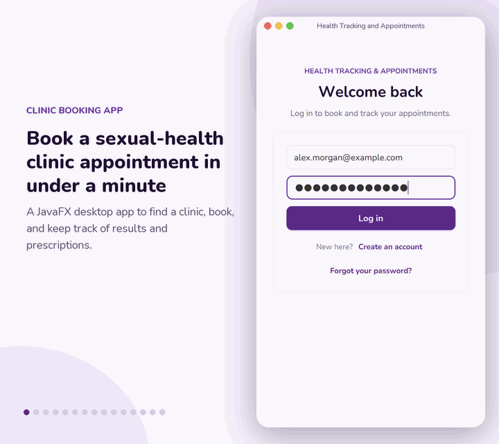
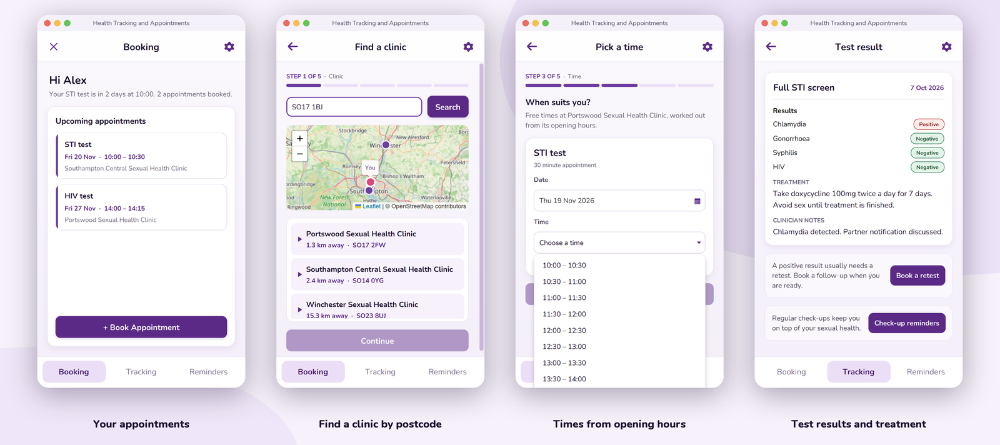
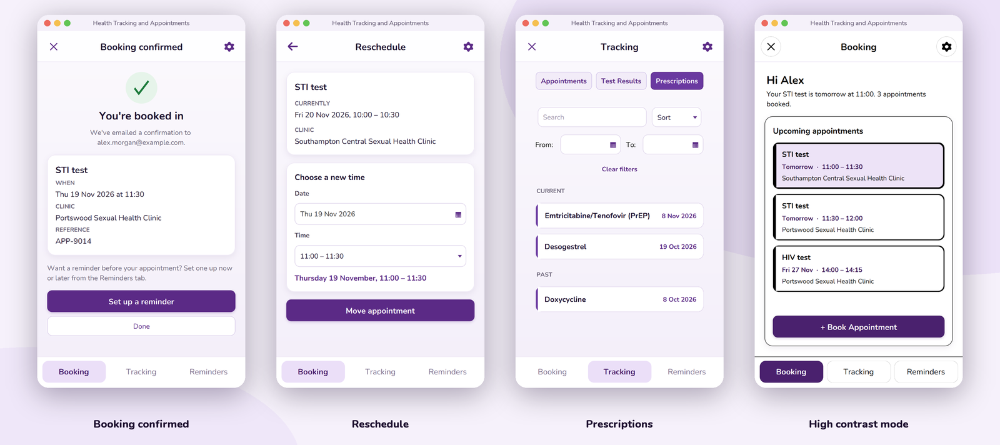

# Sexual Health Clinic App

Book a sexual-health clinic appointment in under a minute: a JavaFX desktop app to find a clinic by postcode, book a slot, and keep track of test results, prescriptions and reminders.





> **Bring your own database.** The app needs a PostgreSQL database that you provide; no shared or hosted database is included. Point `DB_URL`, `DB_USERNAME` and `DB_PASSWORD` in `.env` at any PostgreSQL 13+ (a local install, Docker, or a free hosted one such as Neon or Supabase). The tables are created automatically on first run, and `docs/sample-data.sql` adds demo clinics. See [Getting API keys / credentials](#getting-api-keys--credentials).

> **Group project.** Built by a team for the University of Southampton *Software Design and Development Project* (COMP2300, 2025–26). This repo is a snapshot of the code, which I continued to develop after the module ended.

## Features

The demo above follows a patient through the app:

1. **Sign in.** Accounts with sign-up checks, PBKDF2-hashed passwords, password reset by an emailed 6-digit code, and a terms and privacy flow.
2. **Everything at a glance.** The home screen greets you, counts down to your next appointment and lists everything you have booked.
3. **Find the nearest clinic.** Search by postcode (free [postcodes.io](https://postcodes.io) API). Clinics are sorted by distance and pinned on an interactive OpenStreetMap map (Leaflet, no API key). Click a pin for the address and choose the clinic straight from the popup. You can save a default clinic, which is offered first next time.
4. **Choose a service.** STI test, HIV test, contraception and so on; tick one or more and expand each to see what it involves.
5. **Pick a free time.** Slots are generated from each clinic's opening hours and the service's length. Only booked slots are stored, and a slot drops out once its bookings reach capacity (reserved with a single conditional update, so it can't be overbooked).
6. **Check and confirm.** A five-step progress bar runs through the booking; the review page shows the clinic, time and your details before you confirm.
7. **Confirmation email.** Booking, reschedule and cancellation emails are HTML (Thymeleaf templates) and are sent in the background, alongside an in-app notification with a booking reference.
8. **Reminders your way.** Set how far ahead you are reminded, repeat reminders, quiet hours, discreet wording, and saved defaults for new bookings; check-up reminders if it has been a while since your last visit.
9. **Manage bookings.** Reschedule to another free slot (the old one is released) or cancel; cancelling always asks first and defaults to keeping the appointment.
10. **Track tests and prescriptions.** Test results with a clear status, treatment and clinician notes (and a shortcut to book a retest after a positive result); current and past prescriptions with dose, frequency and course dates; past appointments. Search, sort and filter each list by date.
11. **Accessible.** Keyboard navigation with visible focus rings, screen-reader labels, and per-user high contrast, bold text and text size settings that apply instantly.



## Stack

Java 21, JavaFX (FXML, MaterialFX, ControlsFX, WebView + Leaflet), PostgreSQL, a DAO/repository data layer, JavaMail with Thymeleaf templates, and `dotenv-java` for configuration. Tests use JUnit 5 with H2. The build uses Maven.

## Prerequisites

- **JDK 21** or newer (`java -version`). Install with `winget install --id EclipseAdoptium.Temurin.21.JDK -e`.
- **Maven 3.9+** (`mvn -v`). Install with `winget install --id Apache.Maven -e`, or use the one bundled with IntelliJ.
- **PostgreSQL** 13 or newer, local or hosted, that you set up yourself (only needed to run the app and the integration tests, not for `mvn test`).
- Optional: an SMTP account for sending emails.

## Setup

```powershell
git clone https://github.com/Maheer1001/clinic-booking-app.git
cd clinic-booking-app
mvn -DskipTests package      # downloads dependencies and compiles
```

Then create a database for the app (next section) and put its details in `.env`. Nothing is shared: every clone uses its own PostgreSQL database.

## Configure

```powershell
Copy-Item .env.example .env
notepad .env
```

`.env` is git-ignored. Keys the app reads (environment variables with the same names also work):

| Key | Required | Used for |
| --- | --- | --- |
| `DB_URL` | yes | JDBC URL, e.g. `jdbc:postgresql://localhost:5432/clinic_booking` |
| `DB_USERNAME` | yes | Postgres user |
| `DB_PASSWORD` | yes | Postgres password |
| `SMTP_HOST` | for email | e.g. `smtp.gmail.com` |
| `SMTP_PORT` | for email | `587` (STARTTLS); Gmail falls back to `465` automatically |
| `SMTP_USERNAME` | for email | SMTP login |
| `SMTP_PASSWORD` | for email | SMTP password / app password |
| `MAIL_FROM` | for email | Sender address |
| `MAIL_FROM_NAME` | no | Sender display name |

Without the SMTP keys the app still runs; it logs `[Email] WARNING` and skips sending.

## Getting API keys / credentials

### PostgreSQL database

1. Install PostgreSQL, either:
   - **winget:** `winget install --id PostgreSQL.PostgreSQL.17 -e` (the installer asks you to set a password for the `postgres` superuser; `psql` is in `C:\Program Files\PostgreSQL\17\bin`), or
   - **Docker:** `docker run -d --name clinic-db -p 5432:5432 -e POSTGRES_PASSWORD=postgres postgres:17`
2. Create a database and user (enter the `postgres` password when prompted):

   ```powershell
   psql -h localhost -U postgres -c "CREATE USER clinic_app WITH PASSWORD 'change-me';"
   psql -h localhost -U postgres -c "CREATE DATABASE clinic_booking OWNER clinic_app;"
   ```

   With Docker, prefix each command with `docker exec -it clinic-db` (e.g. `docker exec -it clinic-db psql -U postgres -c "..."`).
3. Put `DB_URL=jdbc:postgresql://localhost:5432/clinic_booking`, `DB_USERNAME=clinic_app` and `DB_PASSWORD=change-me` in `.env`.
4. Schema: there is no separate migration file. The app creates every table itself on startup (`CREATE TABLE IF NOT EXISTS` in `app.DB.initTables`). It does not add any clinics or services, so load the sample data to get something to book:

   ```powershell
   psql -h localhost -U clinic_app -d clinic_booking -f docs/sample-data.sql
   ```

   With Docker: `Get-Content docs/sample-data.sql | docker exec -i clinic-db psql -U clinic_app -d clinic_booking`.
5. Optional demo patient: after the app has been started once (so all tables exist), load `docs/demo-data.sql` for a fictional patient with upcoming and past appointments, test results and prescriptions (dates are relative to today). Sign in as `alex.morgan@example.com` / `DemoPass2026!`.

   ```powershell
   psql -h localhost -U clinic_app -d clinic_booking -f docs/demo-data.sql
   ```

A hosted Postgres (Neon, Supabase, Render, etc.) also works: copy its JDBC URL into `DB_URL` and add `?sslmode=require`.

### SMTP (email confirmations and reminders)

Gmail with an app password:

1. Turn on 2-Step Verification for your Google account (https://myaccount.google.com/security).
2. Open https://myaccount.google.com/apppasswords, enter a name (e.g. "Clinic app") and click **Create**.
3. Copy the 16-character password into `SMTP_PASSWORD` (no spaces). Set `SMTP_HOST=smtp.gmail.com`, `SMTP_PORT=587`, and your Gmail address as `SMTP_USERNAME` and `MAIL_FROM`.

Alternatives:

- **Mailtrap** (test inbox, nothing is really delivered): sign up at https://mailtrap.io, open **Email Testing > Inboxes > SMTP Settings**, and copy the host (`sandbox.smtp.mailtrap.io`), port `587`, username and password.
- **Brevo** (free real sending): sign up at https://www.brevo.com, go to **SMTP & API > SMTP**, generate an SMTP key, and use host `smtp-relay.brevo.com`, port `587`, your Brevo login as the username and the SMTP key as the password. `MAIL_FROM` must be a sender verified in Brevo.

### Map and postcode lookup

No keys needed. The clinic map uses Leaflet with public OpenStreetMap tiles, and postcode search uses the free https://api.postcodes.io API. Both need internet access; without it the map shows a "Map unavailable" message and the clinic list still works.

## Run

```powershell
mvn clean javafx:run
```

Or in IntelliJ, run `app.Main`. If the database is unreachable the window still opens and shows a "Can't connect to the database" message.

## Test

```powershell
mvn test                 # 299 unit tests, no database needed (tests tagged "db" are excluded)
mvn test -Pdb-tests      # also runs the 9 integration tests against the Postgres in .env
```

Email sending is disabled during tests (`-Demail.disabled=true` is set by the build).

### Screenshots

The images above come from a screenshot harness (`src/test/java/dev`) that drives the real app through every screen. With the demo data loaded and a desktop session:

```powershell
mvn -Pscreenshots test-compile exec:exec                      # PNGs in target/screenshots
mvn -Pscreenshots test-compile exec:exec -Dshots.only=book    # just the booking flow
```

It books and moves appointments, so reload `docs/demo-data.sql` before running it again.

More setup notes and troubleshooting: [`docs/SETUP.md`](docs/SETUP.md).

## Docs

- [`docs/ARCHITECTURE.md`](docs/ARCHITECTURE.md): packages, data flow and key classes
- [`docs/SETUP.md`](docs/SETUP.md): fresh install and common errors
- `src/*.puml`: class diagram, ERD and sequence diagrams (auth, booking, cancel/reschedule, reminders, tracking)
